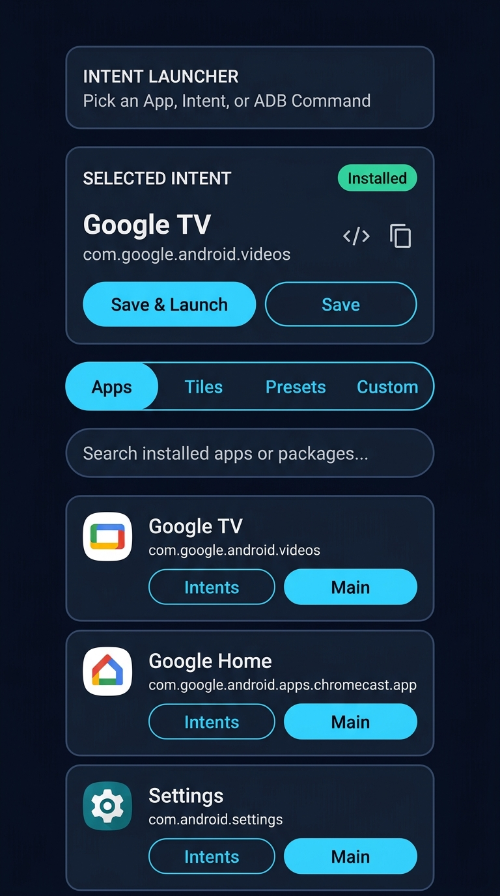
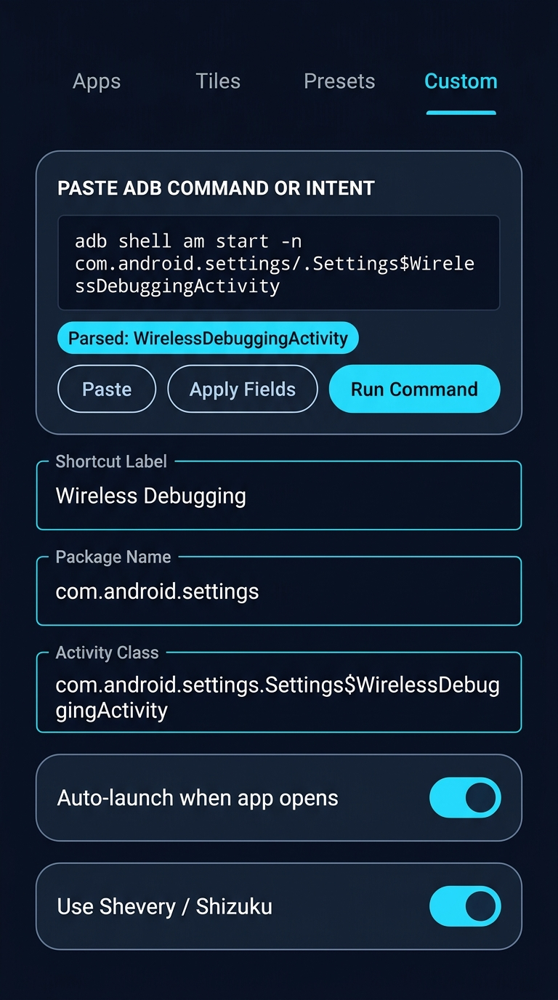
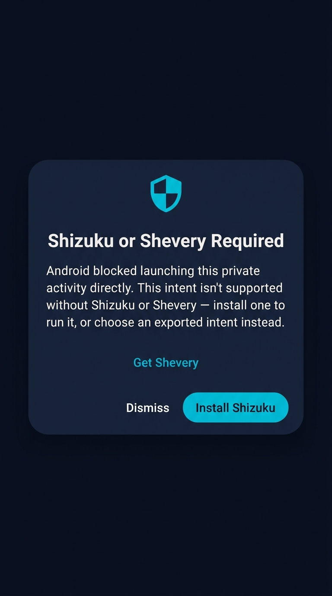

# Button Intent Launcher

**Button Intent Launcher** is a lightweight Android utility that turns any app, specific Activity, Intent, Quick Settings tile, or `adb shell` command into a one-tap launcher shortcut — with **native-first execution** and optional **Shizuku / Shevery** fallback for restricted system targets.

---

## Download APK

- **Latest APK (v5.0):** [**Download `ButtonIntentLauncher-v5.0.apk`**](releases/ButtonIntentLauncher-v5.0.apk)
- Or download automated builds from the **Releases** / **Actions** tabs once pushed to GitHub.

> **Install note:** Enable *Install unknown apps* if installing directly on Android. The APK is signed consistently so future builds update in place.

---

## Screenshots

| App & Intent Browser | Custom ADB & Auto-Launch | Native-First Shizuku Prompt |
| :---: | :---: | :---: |
|  |  |  |

---

## Features

- **Native-First Launch Order**
  - Always tries launching your target directly using Android's standard `startActivity` first — **no Shizuku or Shevery needed** for normal apps, URLs, and exported activities.
  - Only falls back to **Shizuku / Shevery** if Android denies permission (private/unexported activities, Quick Settings tiles, or custom ADB extra flags).
  - If a target is blocked natively and neither Shizuku nor Shevery is installed, an explanatory prompt guides you directly to install **Shizuku** or **Shevery**.
- **Auto-Launch on Open**
  - Once you select and save a target, opening **Button Intent Launcher** immediately jumps straight to that target and closes the launcher task.
  - To change your target later, long-press the **Button Intent Launcher** app icon and tap **Select Intent** (or toggle off *Auto-launch when app opens* in the **Custom** tab).
- **App & Intent Inspector**
  - Browse installed apps, launch their main entry, or tap **Intents** to inspect every discovered intent, Quick Settings tile, and declared Activity (with an *Exported only* filter).
- **Quick Settings Tiles & Presets**
  - Pick from discovered `TileService` entries (`cmd statusbar click-tile`) or built-in presets like Google TV, Google Home, Developer Options, Wireless Debugging, Connected Devices, and Notification History.
- **Paste ADB Commands & Intents**
  - Paste full `adb shell am start ...`, `cmd statusbar click-tile ...`, `intent:#Intent;...;end`, or `package/.Activity` strings directly into the **Custom** tab with live parsing.

---

## How Privileged Fallback Works (Optional)

Standard apps and exported activities work out of the box without any extra tools. For unexported system activities, Quick Settings tiles, or extra ADB flags (`--es`, `--ez`, etc.):

1. Install [**Shizuku**](https://play.google.com/store/apps/details?id=moe.shizuku.privileged.api) (or [**Shevery**](https://github.com/HmnDev-Tech/shevery/releases) with its Shizuku Compatibility Stub enabled).
2. Start the Shizuku / Shevery service.
3. Launch your blocked target in Button Intent Launcher — after Android denies native access, Button Intent Launcher automatically prompts for Shizuku permission and runs the target via its privileged user service.

---

## Building from Source

Requirements: JDK 17+, Android SDK (API 36), Gradle 9.3.1.

```bash
# Restore the debug signing keystore
base64 -d debug.keystore.base64 > debug.keystore

# Build the debug APK
gradle :app:assembleDebug
```

The compiled APK is output to `app/build/outputs/apk/debug/app-debug.apk`.
