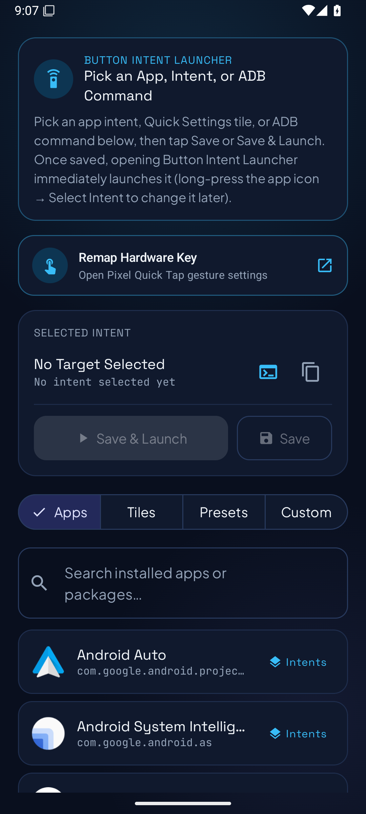
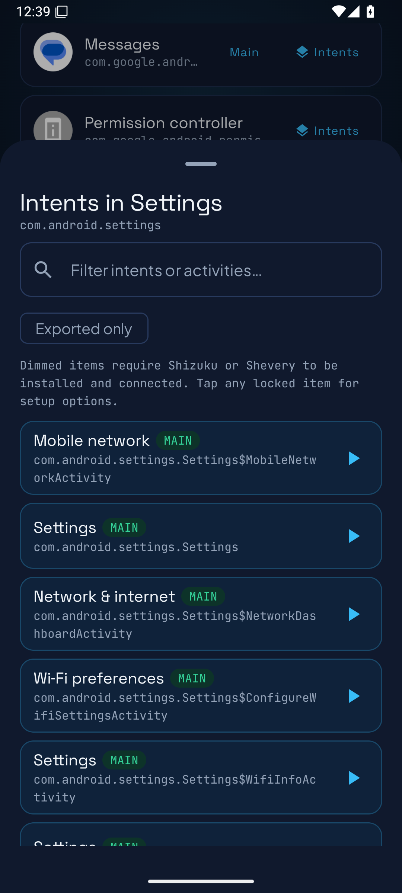
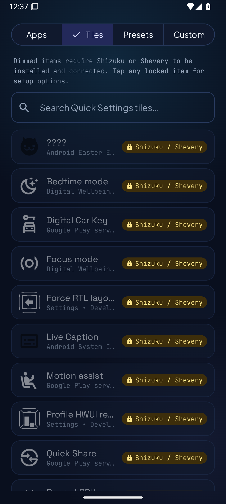
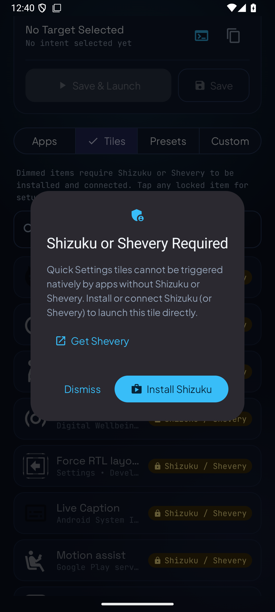

# Button Intent Launcher

**Button Intent Launcher** is a lightweight Android utility that turns any app, specific Activity, Intent, Quick Settings tile, or `adb shell` command into a one-tap launcher shortcut — with **preflight compatibility detection**, **native-first execution**, and optional **Shizuku / Shevery** fallback for restricted system targets.

---

## Download APK

- **Latest APK (v12.1):** [**Download `ButtonIntentLauncher-v12.1.apk`**](releases/ButtonIntentLauncher-v12.1.apk)

> **Install note:** Enable *Install unknown apps* if installing directly on Android. Updating from an earlier build keeps your saved target intact.

---

## Screenshots

| Home & App Browser | Per-App Intents Inspector | Shizuku-Locked Tiles | Shizuku / Shevery Prompt |
| :---: | :---: | :---: | :---: |
|  |  |  |  |

---

## Features

- **Brand-Aware Hardware Key Remapper**
  - Auto-detects your device brand and installed key remappers to open the matching shortcut settings directly from the home screen (prefers **MotoKey+** with stock Motorola Key fallback on Motorola, native **Side button** / **XCover / Active key** with **Good Lock RegiStar** fallback on Samsung, **Quick Tap** on Pixel, or installed **Key Mapper** / **Button Mapper**), hiding automatically if none are present.
- **Preflight Compatibility & Visual Gating**
  - Checks `PackageManager` upfront (`exported` state, required system permissions, Quick Settings tiles, and shell extras) so you know immediately what works without Shizuku.
  - Items that require privileged execution appear dimmed with a **`Shizuku / Shevery`** lock badge across the **Intents sheet**, **Tiles tab**, and **Presets tab** until Shizuku or Shevery is installed and connected.
  - Tapping a locked item displays a tailored setup hint with shortcuts to install or open **Shizuku** / **Shevery**.
- **Native-First Execution**
  - Always tries launching your target directly using Android's standard `startActivity` first — **no Shizuku or Shevery needed** for normal apps, URLs, and exported activities.
  - Only falls back to **Shizuku / Shevery** if Android denies permission (private/unexported activities, Quick Settings tiles, or custom ADB extra flags).
- **Auto-Launch on Open**
  - Once you select and save a target, opening **Button Intent Launcher** immediately jumps straight to that target and closes the launcher task.
  - To change your target later, long-press the **Button Intent Launcher** app icon and tap **Select Intent** (or toggle off *Auto-launch when app opens* in the **Custom** tab).
- **App & Intent Inspector**
  - Browse installed apps, launch their main entry, or tap **Intents** to inspect every discovered intent, Quick Settings tile, and declared Activity (with an *Exported only* filter).
- **Paste ADB Commands & Intents**
  - Paste full `adb shell am start ...`, `cmd statusbar click-tile ...`, `intent:#Intent;...;end`, or `package/.Activity` strings directly into the **Custom** tab with live parsing.

---

## How Privileged Fallback Works (Optional)

Standard apps and exported activities work out of the box without any extra tools. For unexported system activities, permission-protected activities, Quick Settings tiles, or extra ADB flags (`--es`, `--ez`, etc.):

1. Install [**Shizuku**](https://play.google.com/store/apps/details?id=moe.shizuku.privileged.api) (or [**Shevery**](https://github.com/HmnDev-Tech/shevery/releases) with its Shizuku Compatibility Stub enabled).
2. Start the Shizuku / Shevery service — dimmed items across the **Intents sheet**, **Tiles tab**, and **Presets tab** unlock automatically once connected.
3. Launch your target in **Button Intent Launcher** — after Android denies native access, it prompts for Shizuku permission on demand and runs the target via its privileged user service.

---

## Building from Source

Requirements: JDK 17+, Android SDK (API 36), Gradle 9.3.1.

```bash
# Restore or generate a debug signing keystore if missing
if [ -f debug.keystore.base64 ]; then
  base64 -d debug.keystore.base64 > debug.keystore
elif [ ! -f debug.keystore ]; then
  keytool -genkeypair -keystore debug.keystore -storepass android -alias androiddebugkey -keypass android -keyalg RSA -keysize 2048 -validity 10000 -dname "CN=Android Debug,O=Android,C=US"
fi

# Build the debug APK
gradle :app:assembleDebug
```

The compiled APK is output to `app/build/outputs/apk/debug/app-debug.apk`.
